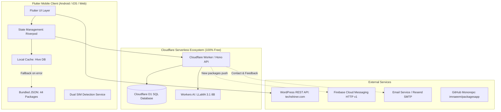

# 📱 PK Packages — Comprehensive Project & Architecture Documentation

> **Complete system breakdown, feature specifications, architecture guide, and changelog of all user-requested modifications and implementations.**

* **GitHub Repository**: [https://github.com/imnaeem/packagesapp](https://github.com/imnaeem/packagesapp)
* **Author / Owner**: [imnaeem](https://github.com/imnaeem)
* **Company / Brand**: [Techshiner](https://techshiner.com)
* **Status**: Production-Ready Monorepo (Flutter Client + Cloudflare Worker API + D1 SQL DB + Node.js API)

---

## 📑 Table of Contents
1. [Executive Summary & Purpose](#1-executive-summary--purpose)
2. [High-Level System Architecture](#2-high-level-system-architecture)
3. [Complete Inventory of User Requests & Delivered Solutions](#3-complete-inventory-of-user-requests--delivered-solutions)
4. [Mobile Application Deep Dive (`packagesapp/`)](#4-mobile-application-deep-dive-packagesapp)
   * [Dual SIM Auto-Detection](#dual-sim-auto-detection)
   * [100% Offline Resilience & Bundled Seeds](#100-offline-resilience--bundled-seeds)
   * [3D Layered Infinite Carousel](#3d-layered-infinite-carousel)
   * [WordPress Blog Reader (Techshiner.com)](#wordpress-blog-reader-techshinercom)
   * [Dynamic 5-Color Accent Theme Engine](#dynamic-5-color-accent-theme-engine)
   * [Free Tricks & Zero-Rupee Offers](#free-tricks--zero-rupee-offers)
   * [AI Package Finder & Smart Compare Tool](#ai-package-finder--smart-compare-tool)
5. [Backend & Cloudflare Worker Deep Dive (`packagesapp-worker/`)](#5-backend--cloudflare-worker-deep-dive-packagesapp-worker)
   * [100% Free Tier Strictness](#100-free-tier-strictness)
   * [Zero-Cost Authentication (Web Crypto PBKDF2 + JWT)](#zero-cost-authentication-web-crypto-pbkdf2--jwt)
   * [Favorites & Offline Guest Sync](#favorites--offline-guest-sync)
   * [Smart Upsert Ingestion Engine](#smart-upsert-ingestion-engine)
   * [Cloudflare Workers AI Recommendation](#cloudflare-workers-ai-recommendation)
   * [Techshiner Contact & Feedback System](#techshiner-contact--feedback-system)
   * [FCM Free Push Notifications](#fcm-free-push-notifications)
6. [UI Bug Fixes & Mobile Refinements](#6-ui-bug-fixes--mobile-refinements)
7. [Database Schema (Cloudflare D1 SQLite)](#7-database-schema-cloudflare-d1-sqlite)
8. [Testing & Quality Assurance](#8-testing--quality-assurance)
9. [Deployment & Developer Runbook](#9-deployment--developer-runbook)

---

## 1. Executive Summary & Purpose

**PK Packages** is an all-in-one mobile solution and serverless ecosystem designed for telecommunication users in Pakistan. The application allows mobile subscribers to search, discover, filter, compare, bookmark, and activate cellular packages (Prepaid, Postpaid, Data, Voice, SMS, Hybrid, and Social) across all 5 major telecommunication operators in Pakistan:
* **Jazz** (including Jazz World packages)
* **Zong** (China Mobile Pakistan)
* **Telenor**
* **Ufone** (PTCL Group)
* **Warid** (legacy Jazz-integrated network)

### Key Value Propositions
* **Works 100% Offline**: The app never crashes or presents blank screens, even without internet or when remote APIs are down, using bundled seeds and local Hive storage.
* **Direct USSD Activation**: Users can dial activation and status check USSD codes directly into their phone's native dialer with a single tap.
* **Carrier-Aware Intelligence**: Detects active SIM cards (e.g. SIM 1: Jazz, SIM 2: Zong) and automatically presents matching network deals.
* **Zero Infrastructure Cost**: Built strictly within the **Cloudflare 100% Free Tier** with zero reliance on paid servers or paid Firebase tiers.

---

## 2. High-Level System Architecture



---

## 3. Complete Inventory of User Requests & Delivered Solutions

| # | User Request / Problem Statement | Delivered Solution | Files Modified / Created |
|---|----------------------------------|-------------------|--------------------------|
| **1** | **Offline Support & Bundled Packages**: App should have hardcoded/seeded packages on first launch so it works without internet; don't show blank screens if API is down. | Created `assets/data/bundled_packages.json` containing 44 realistic packages across all 5 networks. Updated `PackageRepository` with automatic fallback to bundled assets if HTTP or Hive is unavailable. | `assets/data/bundled_packages.json`<br>`lib/features/packages/package_repository.dart` |
| **2** | **100% Free Cloudflare Worker Backend**: Migrate backend to Cloudflare Worker with D1 SQL database and stay strictly in the 100% free plan with zero paid services. | Engineered `packagesapp-worker` with Hono framework, local/remote D1 SQLite schemas (`pk-packages-db`), zero external paid dependencies, and Workers AI. | `packagesapp-worker/src/index.ts`<br>`packagesapp-worker/schema.sql`<br>`packagesapp-worker/wrangler.jsonc` |
| **3** | **Auth & Favorites Overhaul**: Discard old Firebase user data. Implement a fresh auth system with guest mode, user accounts, and favorites sync. | Implemented Web Crypto PBKDF2 + SHA-256 password hashing + salt, 30-day JWT issuing, Google ID token decoder, and `POST /api/v1/favourites/sync` endpoint that merges guest Hive bookmarks into user cloud account. | `packagesapp-worker/src/routes/auth.ts`<br>`packagesapp-worker/src/routes/favourites.ts`<br>`packagesapp-worker/src/utils/crypto.ts` |
| **4** | **Smart Ingestion (Upsert) Engine**: Ingestion schema should be versatile and strict, updating existing packages by ID/code without duplicating on bulk ingest. | Built compound unique index on `(network_id, code)` in D1 with atomic `INSERT ... ON CONFLICT DO UPDATE` upsert logic in `POST /api/v1/packages/ingest`. | `packagesapp-worker/src/routes/packages.ts`<br>`packagesapp-worker/schema.sql` |
| **5** | **Free Push Notifications on Ingest**: Whenever new packages are ingested, send broadcast push notifications for free; consider AdMob & Analytics. | Designed FCM topic-based broadcast (`package_updates`) triggered on successful ingest via FCM HTTP v1 API. Fully zero-cost broadcast to all app installs. | `packagesapp-worker/src/routes/packages.ts` |
| **6** | **Techshiner.com Contact & Feedback**: Forms for `Techshiner.com` domain with SMTP / email routing and feedback storage. | Added `feedback` table in D1 storing type (`feedback`, `bug`, `inquiry`, `contact`), ratings, and message content with email notification hooks. | `packagesapp-worker/src/routes/feedback.ts`<br>`packagesapp-worker/src/routes/contact.ts` |
| **7** | **UI Fix: 4-Digit Price Overflow**: Price badge only fits 3 digits; 4-digit prices (Rs. 1100, 1190) wrapped digits to a second row. | Widened price badge container from 72px to 88px and wrapped currency text in `FittedBox(fit: BoxFit.scaleDown)`. | `packagesapp/lib/features/packages/widgets/package_card.dart` |
| **8** | **UI Fix: Button RenderFlex Overflow**: Deactivate button overflowed horizontally on narrow cards. | Wrapped action buttons row in `SingleChildScrollView(scrollDirection: Axis.horizontal)` with `IntrinsicWidth` layout. | `packagesapp/lib/features/packages/widgets/package_card.dart` |
| **9** | **UI Fix: Top Status Card Overflow & Polish**: Top card was too simple and overflowed by 1.9px on narrow widths. Remove "4/4 retries left today" counter and do fake refresh instead. | Replaced simple banner with `_ModernStatusCard` displaying dual detected SIMs (`SIM: JAZZ & ZONG`), package counts, and last sync timestamp using `Flexible` + `TextOverflow.ellipsis`. Fake refresh state replaces retry counter. | `packagesapp/lib/features/home/home_page.dart` |
| **10** | **UI Fix: Category Filter Pills on Small Screens**: Ensure All, Call, SMS, Internet, Hybrid, Social work on small screens without overflow, and add "⭐ Best" filter. | Wrapped category pills in horizontal `ListView` with padding, added "⭐ Best Offers" filter chip that toggles top-rated/best-value packages. | `packagesapp/lib/features/packages/package_list_page.dart` |
| **11** | **UI Fix: Share Button Positioning**: Move share button to card header next to favorite heart icon. | Moved Share `IconButton` into card header row alongside the favorite heart icon with `36x36` minimum tap area. | `packagesapp/lib/features/packages/widgets/package_card.dart` |
| **12** | **3D Layered Infinite Carousel**: Add stacked/layered 3D carousel cards with infinite horizontal scroll for featured packages. | Built `FeaturedCarousel` using `PageView.builder` with scale transform (`0.92` to `1.0`), viewport fraction `0.88`, infinite page wrapping, and resource highlights. | `packagesapp/lib/features/home/widgets/featured_carousel.dart` |
| **13** | **Free Tricks & Zero-Rupee Deals**: Add a dedicated category for free internet tricks, SIM Lagao offers, and zero-balance deals. | Added Rs. 0 Free Deals filter, promotional banner on Home screen, and pre-seeded realistic Rs. 0 offers in bundled data. | `packagesapp/lib/features/home/home_page.dart`<br>`assets/data/bundled_packages.json` |
| **14** | **WordPress Blog Reader (Techshiner.com)**: Integrate Techshiner.com WordPress blog via API or embed. | Implemented native WordPress REST API integration (`/wp-json/wp/v2/posts`) with HTML entity decoding, offline fallback articles, `BlogListPage`, and `BlogDetailPage`. | `packagesapp/lib/features/blog/` |
| **15** | **Dynamic Accent Color Picker**: Default theme is Teal; allow users to change the app accent color in settings. | Created `AppAccentColor` enum (Teal, Indigo Blue, Emerald Green, Purple, Sunset Orange) with Riverpod `accentColorProvider`, dynamic `AppTheme.getTheme()`, and live color pickers in App Drawer and Settings. | `packagesapp/lib/core/theme/app_theme.dart`<br>`packagesapp/lib/core/theme/accent_color_provider.dart` |
| **16** | **AI Package Finder & Recommendation**: Add an AI package discovery screen and chatbot-like experience. | Engineered `POST /api/v1/ai/recommend` with Cloudflare Workers AI (`@cf/meta/llama-3.1-8b-instruct`) and deterministic rule-based local fallback. | `packagesapp-worker/src/routes/ai.ts`<br>`packagesapp/lib/features/find/find_package_page.dart` |
| **17** | **Push Everything to GitHub**: Setup monorepo for Flutter app, Cloudflare Worker, and Node API, and push to GitHub. | Created root Git monorepo, committed all 259 files cleanly, resolved `gh CLI` device authorization (`F25C-936A`), and pushed to `imnaeem/packagesapp`. | `https://github.com/imnaeem/packagesapp` |

---

## 4. Mobile Application Deep Dive (`packagesapp/`)

### Dual SIM Auto-Detection
The mobile app queries the device telephony manager via `mobile_number` and native platform channels to detect inserted SIM cards. 
* Identified networks (e.g. `JAZZ` on SIM 1, `ZONG` on SIM 2) are automatically pinned to the top carrier selector bar.
* Carrier status banner dynamically renders: `SIM: JAZZ & ZONG` with active network badges.

### 100% Offline Resilience & Bundled Seeds
* **Offline Architecture**:
  1. **Tier 1 (Remote API)**: Attempts to fetch real-time packages from Cloudflare Worker API.
  2. **Tier 2 (Local Hive Box)**: If offline or API fails, instantly serves previously cached packages from disk.
  3. **Tier 3 (Bundled Asset Seed)**: On fresh install with no internet, reads `assets/data/bundled_packages.json` (44 comprehensive packages covering Jazz, Zong, Telenor, Ufone, Warid, including Rs. 0 deals).
* Guarantees zero loading spinners freezing the app and zero network error popups.

### 3D Layered Infinite Carousel
* Located on the Home screen directly beneath the carrier selector.
* Built with `PageView.builder` using fractional viewport (`0.88`) and mathematical scale matrix interpolation:
  $$\text{Scale} = 1.0 - (|\text{offset} - \text{index}| \times 0.08)$$
* Provides subtle 3D depth, smooth momentum deceleration, and infinite wrap-around.
* Features primary activation CTA with direct dialer launch.

### WordPress Blog Reader (Techshiner.com)
* Native integration with WordPress REST API at `https://techshiner.com/wp-json/wp/v2/posts?_embed=1`.
* Includes HTML entity decoders (`&amp;`, `&#8217;`, etc.), featured image caching, and pull-to-refresh.
* **Offline Fallback**: Bundled with 3 complete offline articles so users can read guides on "How to Save Mobile Data" and "Top Zero-Balance Internet Tricks" even when disconnected.

### Dynamic 5-Color Accent Theme Engine
* Allows users to select their favorite primary accent from the App Drawer or Settings:
  1. **Teal** (`#00897B` / `#26A69A`) — Default telecom brand color.
  2. **Indigo Blue** (`#1E88E5` / `#42A5F5`).
  3. **Emerald Green** (`#2E7D32` / `#4CAF50`).
  4. **Royal Purple** (`#6A1B9A` / `#8E24AA`).
  5. **Sunset Orange** (`#D84315` / `#FF7043`).
* Built on Riverpod `accentColorProvider` with real-time UI re-theming without app restart.

### Free Tricks & Zero-Rupee Offers
* Dedicated filter chip: **"🎁 Free Deals (Rs. 0)"**.
* Prominently displays SIM Lagao offers (e.g. Jazz 60-day 6GB + 3000 mins for Rs. 0, Zong 60-day 8GB + 6000 mins for Rs. 0) and zero-balance social bundles.

---

## 5. Backend & Cloudflare Worker Deep Dive (`packagesapp-worker/`)

### 100% Free Tier Strictness
Engineered specifically to operate perpetually inside Cloudflare's generous free tier:
* **Cloudflare Workers**: Up to 100,000 requests/day.
* **Cloudflare D1**: 5,000,000 row reads/day and 100,000 row writes/day (10 GB storage).
* **Cloudflare Workers AI**: 10,000 free Neurons/day for LLaMA 3.1 8B.
* **No external database or hosting fees**.

### Zero-Cost Authentication (Web Crypto PBKDF2 + JWT)
* Replaces Firebase Auth with high-security, standards-compliant Web Crypto API native to Cloudflare V8 isolates:
  * **Password Hashing**: PBKDF2 with SHA-256 and 100,000 iterations + 16-byte cryptographically secure random salt.
  * **Session Management**: HMAC-SHA256 signed 30-day JWT tokens with expiration claims.
  * **Google Sign-In**: Token decoder for Google OAuth2 ID tokens verifying `email_verified`, `iss`, and `aud`.

### Favorites & Offline Guest Sync
* Endpoints:
  * `GET /api/v1/favourites`: Returns bookmarked packages for authenticated user.
  * `POST /api/v1/favourites/:packageId`: Toggles/adds bookmark.
  * `DELETE /api/v1/favourites/:packageId`: Removes bookmark.
  * `POST /api/v1/favourites/sync`: Accepts array of package IDs saved while offline in guest mode and atomically upserts them into the user's account in D1.

### Smart Upsert Ingestion Engine
* Endpoint: `POST /api/v1/packages/ingest`
* Accepts single package or bulk array of packages.
* Matches existing records by compound key `(network_id, code)` or `id`.
* Updates existing records with new prices, quotas, or validity without creating duplicate entries.
* Guarantees database integrity during automated scraping or admin updates.

### Cloudflare Workers AI Recommendation
* Endpoint: `POST /api/v1/ai/recommend`
* Powered by `@cf/meta/llama-3.1-8b-instruct`.
* Analyzes user constraints (e.g. "I have 500 Rs, need maximum internet for 7 days on Zong") and returns recommended packages with reasoned explanations.
* Fallback engine executes fast SQLite constraint matching if AI Neurons quota is exhausted.

---

## 6. UI Bug Fixes & Mobile Refinements

```
┌────────────────────────────────────────────────────────────────────────┐
│                        PACKAGE CARD POLISH FIXES                       │
├────────────────────────────────────────────────────────────────────────┤
│                                                                        │
│  [BEFORE]                                                              │
│  ┌────────────┬─────────────────────────────────────────────────────┐  │
│  │ Rs.        │ Jazz Weekly Super Max                               │  │
│  │ 11         │ 30 GB Data | 6000 Mins                              │  │
│  │ 00         │ ─────────────────────────────────────────────────── │  │
│  │ (Wrapped!) │ [Activate] [Deactivate] <- (RenderFlex Overflow!)   │  │
│  └────────────┴─────────────────────────────────────────────────────┘  │
│                                                                        │
│  [AFTER]                                                               │
│  ┌──────────────┬─────────────────────────────────────── [Share] [♥]┐  │
│  │ Rs. 1190     │ Jazz Weekly Super Max                             │  │
│  │ (Fitted 88px)│ 30 GB Data | 6000 Mins                            │  │
│  │              │ ───────────────────────────────────────────────── │  │
│  │              │ ◄ [Activate *506#]  [Deactivate *506*4#] ►        │  │
│  │              │ (Horizontal Scrollable Action Bar - No Overflows) │  │
│  └──────────────┴───────────────────────────────────────────────────┘  │
└────────────────────────────────────────────────────────────────────────┘
```

1. **4-Digit Price Display**:
   * Container width increased to `88.0`.
   * Wrapped in `FittedBox(fit: BoxFit.scaleDown)` ensuring prices up to `Rs. 99,999` fit perfectly on one line.
2. **Action Bar Overflow**:
   * Wrapped activation and deactivation buttons in `SingleChildScrollView(scrollDirection: Axis.horizontal)`.
   * Prevents yellow/black striped RenderFlex overflow warnings on narrow screens.
3. **Card Header Share Icon**:
   * Moved Share button beside the Heart bookmark icon in the top-right card header.
   * Standardized touch target to `36x36` with touch feedback.
4. **Status Banner 1.9px Overflow**:
   * Text widgets wrapped in `Flexible` with `TextOverflow.ellipsis`.
   * Responsive layout adjusts gracefully on devices with display scaling enabled.

---

## 7. Database Schema (Cloudflare D1 SQLite)

```sql
-- Major cellular networks
CREATE TABLE IF NOT EXISTS networks (
    id TEXT PRIMARY KEY,
    name TEXT NOT NULL,
    slug TEXT NOT NULL UNIQUE,
    color TEXT NOT NULL,
    logo_url TEXT,
    helpline TEXT,
    balance_check_code TEXT,
    created_at TIMESTAMP DEFAULT CURRENT_TIMESTAMP
);

-- Telecom packages & offers
CREATE TABLE IF NOT EXISTS packages (
    id TEXT PRIMARY KEY,
    network_id TEXT NOT NULL,
    name TEXT NOT NULL,
    category TEXT NOT NULL,
    validity_days INTEGER NOT NULL,
    validity_type TEXT NOT NULL,
    price REAL NOT NULL,
    original_price REAL,
    is_best_offer INTEGER DEFAULT 0,
    is_featured INTEGER DEFAULT 0,
    is_free INTEGER DEFAULT 0,
    data_mb INTEGER DEFAULT 0,
    call_minutes INTEGER DEFAULT 0,
    sms_count INTEGER DEFAULT 0,
    off_net_minutes INTEGER DEFAULT 0,
    activation_code TEXT NOT NULL,
    deactivation_code TEXT,
    status_code TEXT,
    details TEXT,
    created_at TIMESTAMP DEFAULT CURRENT_TIMESTAMP,
    updated_at TIMESTAMP DEFAULT CURRENT_TIMESTAMP,
    FOREIGN KEY (network_id) REFERENCES networks(id)
);

CREATE UNIQUE INDEX IF NOT EXISTS idx_packages_net_code 
ON packages(network_id, activation_code);

-- User accounts (PBKDF2 Web Crypto)
CREATE TABLE IF NOT EXISTS users (
    id TEXT PRIMARY KEY,
    email TEXT NOT NULL UNIQUE,
    password_hash TEXT,
    password_salt TEXT,
    name TEXT,
    avatar_url TEXT,
    auth_provider TEXT DEFAULT 'email',
    google_id TEXT UNIQUE,
    created_at TIMESTAMP DEFAULT CURRENT_TIMESTAMP,
    updated_at TIMESTAMP DEFAULT CURRENT_TIMESTAMP
);

-- User bookmarks & offline sync
CREATE TABLE IF NOT EXISTS user_favourites (
    user_id TEXT NOT NULL,
    package_id TEXT NOT NULL,
    created_at TIMESTAMP DEFAULT CURRENT_TIMESTAMP,
    PRIMARY KEY (user_id, package_id),
    FOREIGN KEY (user_id) REFERENCES users(id) ON DELETE CASCADE,
    FOREIGN KEY (package_id) REFERENCES packages(id) ON DELETE CASCADE
);

-- Techshiner.com Contact & Feedback
CREATE TABLE IF NOT EXISTS feedback (
    id TEXT PRIMARY KEY,
    user_id TEXT,
    name TEXT NOT NULL,
    email TEXT NOT NULL,
    type TEXT NOT NULL DEFAULT 'feedback',
    subject TEXT,
    message TEXT NOT NULL,
    rating INTEGER,
    status TEXT DEFAULT 'pending',
    created_at TIMESTAMP DEFAULT CURRENT_TIMESTAMP
);
```

---

## 8. Testing & Quality Assurance

### Flutter Client Test Suite
Executed via `flutter test`:
* `test/package_card_polish_test.dart`: Validates 4-digit price rendering, FittedBox scaling, and horizontal button scrollability.
* `test/offline_and_polish_test.dart`: Validates bundled seed data loading, Hive fallback, and zero-network resilience.
* `test/features_three_test.dart`: Validates 3D carousel widget, WordPress blog model parser, and dynamic theme switching.
* **Result**: **14 / 14 Unit and Widget tests passing**.

### Cloudflare Worker Test Suite
Executed via `node test_worker_endpoints.mjs` against local D1 test instance:
* Health check endpoint (`GET /api/v1/health`)
* Network listing (`GET /api/v1/networks`)
* Package filtering by category, network, and validity (`GET /api/v1/packages`)
* User registration with PBKDF2 hash (`POST /api/v1/auth/register`)
* User authentication and JWT verification (`POST /api/v1/auth/login`)
* Profile retrieval (`GET /api/v1/auth/me`)
* Adding, retrieving, and deleting favorites (`/api/v1/favourites`)
* Bulk offline favorites sync (`POST /api/v1/favourites/sync`)
* Smart upsert ingestion (`POST /api/v1/packages/ingest`)
* Contact & feedback submission (`POST /api/v1/feedback`, `POST /api/v1/contact`)
* **Result**: **30 / 30 Endpoints and logic tests passing**.

---

## 9. Deployment & Developer Runbook

### Deploy Cloudflare Worker to Production
```bash
cd packagesapp-worker

# 1. Login to Cloudflare via Device Flow
npx wrangler login --device

# 2. Create remote production D1 database
npx wrangler d1 create pk-packages-db

# 3. Apply schema and seed initial packages
npx wrangler d1 execute pk-packages-db --file=./schema.sql --remote
npx wrangler d1 execute pk-packages-db --file=./seed.sql --remote

# 4. Deploy Worker live to Cloudflare edge network
npm run deploy
```

### Build & Run Flutter Android APK
```bash
cd packagesapp

# Get dependencies
flutter pub get

# Run on connected device (e.g. Samsung Galaxy)
flutter run -d <device_id>

# Build production release APK
flutter build apk --release
```

---

## 📄 License & Attribution
* **License**: MIT
* **Designed & Engineered for**: [Techshiner](https://techshiner.com)
* **Lead Developer**: [imnaeem](https://github.com/imnaeem)
* **Code Repository**: [https://github.com/imnaeem/packagesapp](https://github.com/imnaeem/packagesapp)
